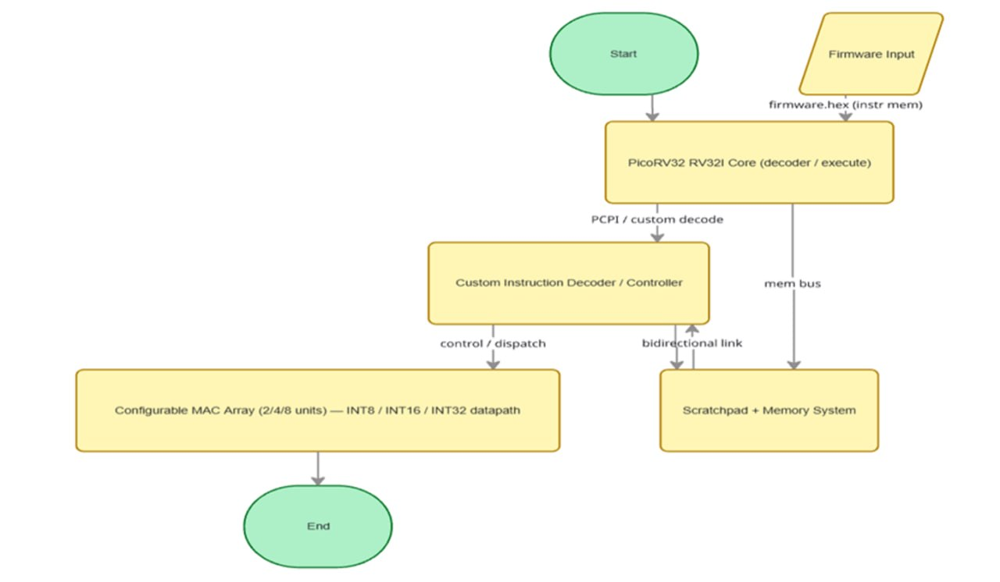
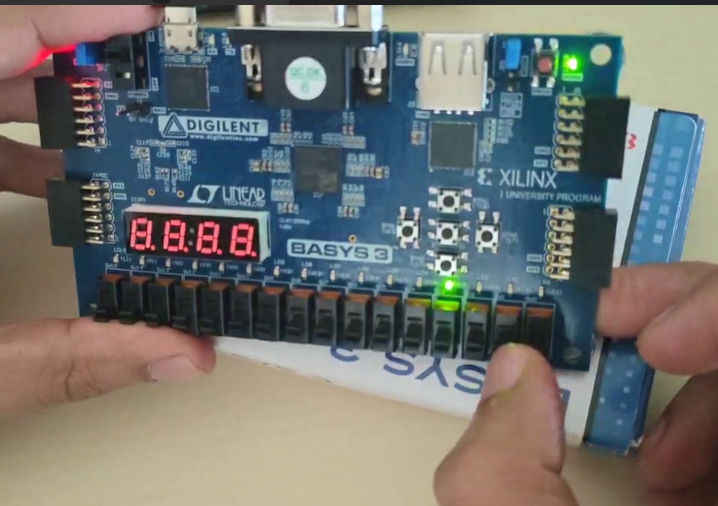
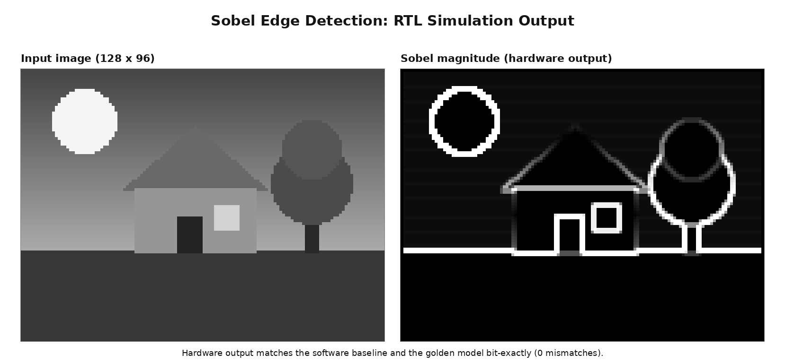
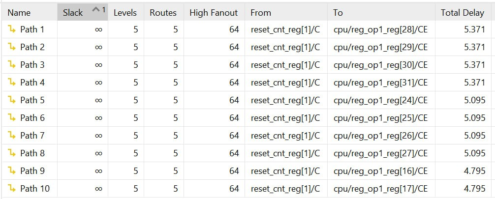
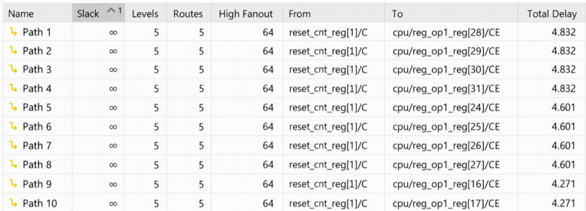
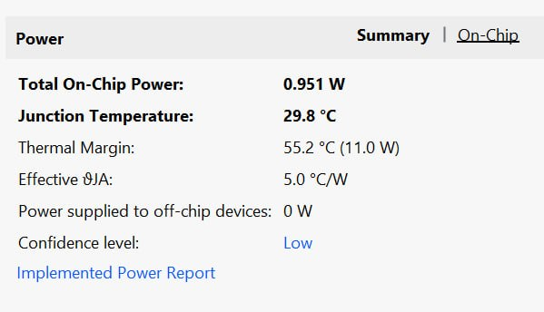
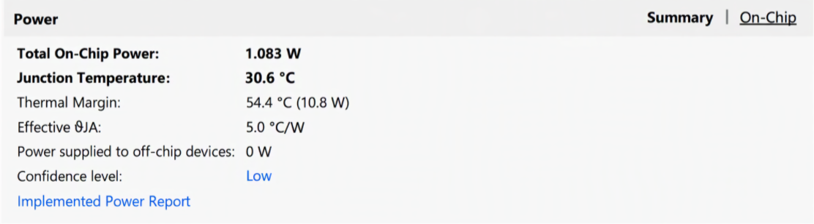

# Design and Evaluation of a Custom RISC-V Instruction Extension for Sobel Edge Detection on FPGA

> **Scope note:** This report describes the implemented Sobel-specific custom-instruction coprocessor and distinguishes it from the broader configurable MAC-array architecture proposed for future work. Vivado results are reported with the limitations visible in the supplied screenshots. The references at the end use the bibliography supplied for this project; no references or measurements have been fabricated.

## LIST OF FIGURES {#list-of-figures}

| Figure | Title | Page No. |
|---|---|---|
| Figure 3.1 | Proposed configurable accelerator architecture |  |
| Figure 3.2 | Basys 3 bare-metal PicoRV32 demonstration |  |
| Figure 3.3 | Sobel RTL simulation output |  |
| Figure 4.1 | Vivado timing-path summary: baseline CPU |  |
| Figure 4.2 | Vivado timing-path summary: custom-instruction design |  |
| Figure 4.3 | Vivado power summary: baseline CPU |  |
| Figure 4.4 | Vivado power summary: custom-instruction design |  |

## LIST OF TABLES {#list-of-tables}

| Table | Title | Page No. |
|---|---|---|
| Table 1.1 | Related work and relevance to this project |  |
| Table 2.1 | Functional and evaluation requirements |  |
| Table 2.2 | Project implementation platform and tools |  |
| Table 3.1 | Implemented Sobel custom instructions |  |
| Table 3.2 | Integrated test memory map |  |
| Table 4.1 | Standalone Sobel coprocessor test cases |  |
| Table 4.2 | Software and custom-instruction Sobel simulation results |  |
| Table 4.3 | Reported timing delay and reciprocal-delay indicator |  |
| Table 4.4 | Vivado total on-chip power estimates |  |
| Table 4.5 | Evidence level and limitations of reported results |  |
| Table 5.1 | Objective completion and evidence |  |

## TABLE OF CONTENTS {#table-of-contents}

| S. No. | Contents | Page No. |
|---|---|---|
| 1 | Introduction |  |
| 2 | Methodology |  |
| 3 | Design and Implementation |  |
| 4 | Results and Analysis |  |
| 5 | Conclusion and Future Work |  |

## ABSTRACT {#abstract}

This project investigates the integration of a custom hardware operation with an embedded RISC-V processor using Sobel edge detection as a representative image-processing workload. PicoRV32 executes a software implementation of the operator and communicates with a dedicated Sobel coprocessor through custom instructions on the Pico Co-Processor Interface. The coprocessor contains three row buffers, a parallel 3 × 3 Sobel datapath, a finite-state controller, and a memory-master interface. A bus arbiter allows the processor and coprocessor to share the memory interface.

Functional verification uses a standalone coprocessor testbench and a full-SoC testbench. The standalone tests cover eleven documented image cases and compare every output byte with a behavioral reference. For an 8 × 8 image in the full-SoC simulation, the software routine requires 5,542 cycles and the custom-instruction path requires 175 cycles, corresponding to a 31.67× simulated cycle-count speedup with a zero-wait memory model. These values are simulation results and are not FPGA wall-clock measurements.

The supplied Vivado timing summaries report delays of 5.1984 ns for the baseline and 4.6273 ns for the custom-instruction configuration. Their reciprocals are approximately 192.37 MHz and 216.11 MHz, but these should be treated as delay-derived indicators rather than verified maximum frequencies: the screenshots show infinite slack and visible total-delay entries that do not match those summary values. Vivado power summaries estimate 0.951 W and 1.083 W respectively, with low confidence. Therefore, the report presents a preliminary indication of lower reported path delay and higher estimated total on-chip power, while identifying the constraint and measurement checks needed for a conclusive comparison. The currently implemented accelerator is Sobel-specific; a configurable multi-lane MAC array remains future work.

**Keywords:** RISC-V, PicoRV32, custom instruction, PCPI, Sobel edge detection, FPGA, Vivado, hardware/software co-design

## CHAPTER 1 — INTRODUCTION {#chapter-1}

### 1.1 Background {#sec-1-1}

Embedded processors are increasingly expected to process sensor and image data locally, where low latency, reduced communication, and privacy can be important. Many image-processing and AI kernels are data-parallel: the same arithmetic operation is repeated across many values. A small scalar processor can execute these kernels in software, but repeated instruction fetch, arithmetic, and memory operations can make the computation slow. This efficiency challenge is central to edge machine learning, where useful computation must fit within limited energy, memory, and cost budgets [1].

Application-specific hardware can execute frequently repeated operations in parallel and reduce software instruction overhead. Research on RISC-V acceleration considers compact specialized engines as one way to improve performance and energy efficiency for data-parallel kernels [1]. A key integration question is how the processor and accelerator communicate: scalable extension interfaces can support custom control, multi-cycle operations, and memory transactions [2]. Other accelerator styles, including analog neural-network hardware, illustrate the wider design space and its precision, scalability, and integration trade-offs [3]. Automatic custom-instruction design studies likewise emphasize that instruction selection and microarchitecture should be considered together rather than judging an extension only by its functional result [4].

This project explores that approach using Sobel edge detection as a representative image-processing workload. The prototype connects a PicoRV32 processor to a dedicated Sobel coprocessor through custom instructions. It is implemented in Verilog and targeted at the Digilent Basys 3 board with an Artix-7 FPGA. Embedded machine-learning design must account for the relationship between workload, memory, precision, and hardware budget [5]. RISC-V's modular ISA and custom opcode space provide the software-visible foundation for instruction extensions [6]. The current accelerator is specialized to Sobel; a general configurable MAC-array accelerator remains a possible extension rather than a completed result.

### 1.2 Related Work {#sec-1-2}

The project is informed by work on RISC-V accelerators, instruction-set extensions, edge-AI design, and FPGA prototyping. Table 1.1 summarizes the supplied references by their relevance to this implementation. The papers motivate accelerator integration and evaluation, but their reported results are not treated as results of this project.

[]{#table-1-1}
**Table 1.1: Related work and relevance to this project**

| Ref. | Work | Main relevance |
|---|---|---|
| [1] | RedMulE, a compact FP16 matrix-multiplication accelerator for a RISC-V SoC | Demonstrates specialized low-power RISC-V acceleration; its matrix engine differs from this Sobel coprocessor. |
| [2] | SCAIE-V, a scalable interface for RISC-V ISA extensions | Provides context for processor-extension interfaces, custom control, multi-cycle operations, and memory interaction. |
| [3] | Review of analog AI hardware for neural networks | Surveys alternative acceleration approaches and precision, scaling, and mixed-signal trade-offs. |
| [4] | Automatic microarchitecture-aware custom-instruction design | Motivates evaluating instruction behavior together with microarchitectural cost and benefit. |
| [5] | TinyML deployment on resource-constrained systems | Provides background on edge inference constraints, memory, and energy. |
| [6] | RISC-V instruction-set manual | Defines the ISA context and custom instruction space used by this class of design. |
| [7] | Xilinx 7-series FPGA data sheet | Device-family context for FPGA implementation and resource analysis. |
| [8] | Digilent Basys 3 reference manual | Board-level context for the target Artix-7 FPGA and I/O. |
| [9] | SystemVerilog verification text | General verification methodology background; this project uses Verilog testbenches. |
| [10] | FPGA prototyping text | Background for FPGA implementation and prototyping workflow. |
| [11] | Data communications and networking | General background for data movement and communication costs; not a direct accelerator result. |
| [12] | Introductory FPGA video | Non-peer-reviewed introductory material only; not used as evidence for technical performance claims. |

Table 1.1 separates literature context from the work reported here. In particular, results from other accelerators [1], [4] cannot be directly compared with this prototype unless workloads, platform, memory behavior, and measurement methods are equivalent. FPGA target selection and physical implementation are tied to the device and board characteristics described in [7], [8].

### 1.3 Problem Statement {#sec-1-3}

A software-only embedded processor must perform the Sobel gradient calculations and image movement as many individual instructions. This creates execution overhead for a workload that repeatedly applies the same operation across an image. A custom hardware unit may reduce that workload's execution time, but the added logic can also affect FPGA area, timing, and power. These effects must be measured and compared against a baseline rather than inferred from simulation cycle counts alone.

The project therefore addresses the following question: **How does integrating a Sobel-specific custom-instruction coprocessor with PicoRV32 affect functional correctness, execution performance, FPGA timing, resource use, and estimated power compared with a software-only PicoRV32 configuration?**

### 1.4 Objectives {#sec-1-4}

The objectives of this work are:

1. Integrate PicoRV32 with a PCPI-attached Sobel coprocessor using custom RISC-V instructions.
2. Implement a three-row-buffered Sobel datapath and controller for grayscale image processing.
3. Verify output correctness using standalone coprocessor tests, full-SoC tests, and a golden reference model.
4. Compare software and custom-instruction execution cycle counts on an equivalent image workload.
5. Compare baseline and custom-instruction Vivado timing and power reports, noting measurement limits and report confidence.
6. Document the design's limitations and identify next steps toward a broader configurable accelerator.

### 1.5 Scope and Limitations {#sec-1-5}

The implemented accelerator supports Sobel edge detection with zero-valued image borders and configurable image dimensions up to the configured maximum width. It is integrated through PicoRV32's PCPI signals and accesses image data over the SoC memory bus. Functional simulation includes an 8 × 8 full-SoC comparison and standalone cases with additional image sizes.

This report does not claim that the current design implements matrix multiplication, selectable 2/4/8 MAC lanes, or selectable INT8/INT16/INT32 operation. Simulation uses a zero-wait memory model, so simulated cycles do not include realistic BRAM access latency. Vivado power reports shown here have low confidence, and the timing screenshots require validation of their constraints and reported path values before any maximum-frequency claim is made.

### 1.6 Significance of the Work {#sec-1-6}

The implemented prototype is useful as a hardware/software co-design exercise for three reasons. First, it demonstrates an accelerator that is invoked through processor-visible custom instructions instead of requiring the application to use an unrelated external controller. Second, it includes a memory master and arbitration logic, so the accelerator operates on image data rather than only computing a single arithmetic operation from register operands. Third, it uses both a software result and a separate golden model to check correctness. These properties make it possible to study the interaction between instruction execution, memory traffic, datapath design, and FPGA implementation.

The work is also deliberately bounded. Sobel is a deterministic image filter and is not representative of every neural-network kernel. Its use allows exact output comparison and makes it easier to isolate integration overhead. Claims about broader AI workloads require implementation and evaluation of those workloads; they are not inferred from the Sobel results.

### 1.7 Research Gap and Project Contribution {#sec-1-7}

The supplied literature spans compact arithmetic accelerators, reusable extension interfaces, custom-instruction generation, and resource-constrained AI [1]–[5]. The present project takes a smaller implementation-focused step: it builds and verifies a dedicated Sobel operation around PicoRV32 and collects preliminary FPGA timing and power summaries. The contribution reported here is the integrated prototype and its evaluation methodology, not a new general-purpose AI instruction standard or a completed configurable MAC-array architecture.

The specific contributions are:

1. A custom opcode protocol for Sobel configuration, execution, status, and reset.
2. A three-row line-buffered coprocessor with parallel horizontal and vertical gradient arithmetic.
3. A memory-bus integration path with CPU/coprocessor arbitration while a PCPI operation is active.
4. A simulation suite covering multiple image dimensions and comparing software and hardware output to a golden model.
5. A preliminary comparison of the supplied Vivado timing and power summaries, with the discrepancies and confidence limitations explicitly documented.

### 1.8 Report Organization {#sec-1-8}

Chapter 1 introduces the problem, objectives, and scope. Chapter 2 presents the methodology and evaluation conditions. Chapter 3 describes the implemented architecture, custom instructions, and FPGA prototype. Chapter 4 presents functional, simulation, timing, and power results and discusses their limitations. Chapter 5 summarizes the conclusions and future work.

## CHAPTER 2 — METHODOLOGY {#chapter-2}

This chapter describes the implemented system, the software-versus-hardware experiment, and the methods used to verify functionality and compare performance. The work uses an incremental hardware/software co-design process: first establish a PicoRV32 baseline, then integrate a custom coprocessor, verify its output against a software reference, and finally evaluate the design on the target FPGA when implementation results are available. Custom instruction interfaces are a common way to couple application-specific execution units to RISC-V processors [2], [6].

### 2.1 Project Approach {#sec-2-1}

The project proceeds through the following stages:

1. **Baseline processor integration:** PicoRV32 is connected to instruction and data memory and configured to expose its Pico Co-Processor Interface (PCPI).
2. **Benchmark definition:** A grayscale 3 × 3 Sobel edge detector is used as a deterministic workload with a byte-exact software reference.
3. **Software baseline:** The CPU computes the Sobel output using RV32I instructions and a sliding 3 × 3 window.
4. **Custom instruction implementation:** A PCPI coprocessor accepts Sobel configuration and execution commands, loads the image through the memory bus, computes output pixels, and writes the result.
5. **Functional verification:** Standalone and full-SoC testbenches compare results against a behavioral golden model.
6. **Performance and FPGA evaluation:** Simulation cycle counts are reported separately from post-implementation timing, area, and power. Preliminary timing and power summaries are available for the baseline and custom-instruction configurations; timing values and constraints must be reconciled, and comparable resource results are still required.

The project repository includes the custom coprocessor and simulation tests. The documented FPGA demonstration applies to the baseline CPU integration; the current evidence does not establish that the Sobel-enabled design has been tested on the Basys 3 board.

### 2.2 System Requirements {#sec-2-2}

The functional requirements are to accept an image base address and dimensions, process the image using the defined Sobel operator, write exactly one output byte for every input pixel, and report completion or an error. The output must match the reference behavior, including zero-valued borders and saturation to the 8-bit output range.

The integration requirements are that the processor can issue custom operations through PCPI, the coprocessor can request data-memory transactions, and the CPU and coprocessor do not drive the memory interface as simultaneous owners. The evaluation requirements are that software and hardware process equivalent input data, functional correctness is checked independently, and simulation metrics are not conflated with post-implementation FPGA metrics.

Table 2.1 groups these requirements by evaluation layer. It distinguishes implemented functional behavior from measurement requirements: for example, the RTL can be synthesized for an FPGA, but a power report is not a direct measurement of energy consumed by one Sobel run.

[]{#table-2-1}
**Table 2.1: Functional and evaluation requirements**

| Requirement | Verification or evidence |
|---|---|
| Correct Sobel gradients, magnitude, and saturation | Compare each output byte to the golden function |
| Zero-valued image borders | Check output pixels on all four borders |
| Exact output byte count | Check `SOBEL_RUN` return value against width × height |
| Custom instruction recognition | Exercise each supported function code |
| Memory arbitration during coprocessor operation | Run the integrated CPU and coprocessor test |
| Software/hardware equivalence | Compare software and accelerator output buffers |
| FPGA timing comparison | Use equivalent constraints and implemented timing reports |
| FPGA resource comparison | Use utilization reports for both top-level configurations |
| Power comparison | Report Vivado estimate, confidence, and activity assumptions |

### 2.3 Hardware and Software Platform {#sec-2-3}

Table 2.2 summarizes the implementation platform and tools. The FPGA family and board are identified in the project documentation; Vivado 2025.2 is the version recorded there. Confirm the exact tool version and device selected in the Vivado project before final submission.

[]{#table-2-2}
**Table 2.2: Project implementation platform and tools**

| Item | Selection |
|---|---|
| FPGA development board | Digilent Basys 3 |
| FPGA device | Xilinx Artix-7 XC7A35T |
| Processor | PicoRV32, RV32I configuration |
| Accelerator interface | Pico Co-Processor Interface (PCPI) |
| RTL | Verilog |
| Simulation | Icarus Verilog 11.0 |
| FPGA synthesis and implementation | Xilinx Vivado; project documentation records version 2025.2 |
| Board constraints | `RiscV_Basys3_Regular/basys3.xdc` |
| Test firmware and image | `firmware.hex` and `data.hex` |

The Basys 3 is based on a Xilinx Artix-7 device [7], [8]. The report should state the exact part and package selected in the Vivado project rather than relying only on the board name. The current RTL uses a 100 MHz clock constraint in the supplied XDC. This is a requested timing target, not proof that the design meets that target.

### 2.4 Sobel Benchmark {#sec-2-4}

The benchmark operates on an 8-bit grayscale image. For each interior pixel, the horizontal and vertical Sobel gradients are computed from the surrounding 3 × 3 neighborhood:

```text
Gx = (p02 + 2p12 + p22) - (p00 + 2p10 + p20)
Gy = (p20 + 2p21 + p22) - (p00 + 2p01 + p02)
output = min(|Gx| + |Gy|, 255)
```

The outermost image border is set to zero. This definition is used by both the software routine and the hardware reference model, so that output comparisons test equivalent behavior.

The kernels use the conventional Sobel masks:

```text
       -1  0 +1              -1 -2 -1
Gx =   -2  0 +2       Gy =    0  0  0
       -1  0 +1              +1 +2 +1
```

For pixel coordinates `(x, y)`, only `1 <= x < W-1` and `1 <= y < H-1` use the gradients. All other output coordinates are defined as zero. The gradient magnitude approximation used here is `|Gx| + |Gy|`, followed by saturation at 255; it is not the Euclidean magnitude `sqrt(Gx² + Gy²)`. Keeping this definition explicit ensures that software and hardware compare the same algorithm.

### 2.5 Software and Hardware Comparison {#sec-2-5}

The software baseline uses a sliding window: it initially loads the neighborhood and then loads only the newly entering column as it moves across a row. This is a more efficient baseline than recomputing each neighborhood with nine independent pixel loads. The hardware implementation keeps three image rows in line buffers and evaluates the gradient datapath in parallel. Its intended advantage is reducing repeated memory reads and instruction execution, rather than relying on a higher processor clock frequency.

The full-SoC firmware runs both methods on the same 8 × 8 image, records processor cycle and retired-instruction counts for each computation, and checks that the two output buffers match. The testbench independently checks both outputs against a golden Sobel model.

For the reported simulation experiment:

```text
simulation speedup = software cycle count / hardware cycle count
cycles per pixel   = measured cycle count / number of image pixels
```

FPGA execution time must be calculated using the measured cycle count and the achieved clock frequency, not by treating simulation cycles as elapsed FPGA time. The FPGA comparison must use the same device, timing constraints, input dimensions, memory implementation, and Vivado implementation settings for both designs.

For a design whose implemented clock is `f_clk`, the idealized execution-time calculation is:

```text
execution_time = workload_cycles / f_clk
```

This calculation is only meaningful when the cycle count and clock frequency refer to the same implemented configuration and workload. If cycle count comes from a zero-wait simulation while frequency comes from a separately constrained FPGA build with different memory behavior, the product has a model mismatch and must be labeled as an estimate.

### 2.6 Verification Method {#sec-2-6}

Verification is performed at two levels:

- **Standalone coprocessor tests:** The PCPI unit is driven directly with a zero-wait memory model. Each output pixel and the returned pixel count are checked against the golden model.
- **Full-SoC integration test:** The PicoRV32 executes the firmware, runs the software and custom-instruction paths, compares their outputs, and records cycle and instruction counts. The testbench also checks the results independently against the golden model.

The simulation regression is run from `RiscV_Basys3_Regular/` using:

```bash
./run_sobel_tests.sh
```

The standalone verification follows a reference-model approach: the input is initialized, the accelerator is run, and every produced byte and the total count are checked. This style is consistent with established hardware verification practice [9], [10]. The project uses Verilog testbenches and Icarus Verilog rather than SystemVerilog classes or constrained-random verification features.

The full-SoC test adds integration checks. It confirms the firmware reaches its completion marker, compares output buffers, and checks both buffers pixel-by-pixel against a golden function. A successful software-versus-hardware comparison alone could miss a shared algorithm error, so the separate golden model provides an additional check.

### 2.7 Metrics and Calculation Methods {#sec-2-7}

The report uses several metrics that measure different aspects of the system:

- **Cycle count:** processor cycles between the selected start and completion reads.
- **Cycles per pixel:** total cycles divided by image width × height. Border pixels are included in the denominator.
- **Cycle-count speedup:** baseline software cycles divided by custom-instruction cycles.
- **Path delay:** a delay reported for a timing path; it is not automatically equivalent to a valid clock period.
- **Timing slack:** required time minus arrival time for a constrained path. Positive slack indicates margin against that path's requirement; an unconstrained path does not provide a valid slack-based pass/fail.
- **Resource utilization:** mapped LUT, flip-flop, BRAM, and DSP counts from implementation reports.
- **Estimated on-chip power:** Vivado's implementation-dependent estimate. It is sensitive to activity assumptions and should not be called a board power measurement.
- **Energy per workload:** average workload power multiplied by workload execution time, provided both values correspond to the same operating conditions and activity profile.

For two positive power estimates `P_base` and `P_custom`, relative power change is:

```text
relative_power_change (%) = (P_custom - P_base) / P_base × 100
```

For resource counts `R_base` and `R_custom`, the analogous relative resource change can be computed for each resource class. LUTs, registers, BRAM, and DSPs should be reported separately rather than collapsed into one arbitrary area value.

### 2.8 FPGA Evaluation Method {#sec-2-8}

The comparison uses two synthesis configurations:

1. **Software-only baseline:** PicoRV32, memory, and the firmware-running application, without the Sobel coprocessor.
2. **Custom-instruction design:** PicoRV32, the Sobel coprocessor, arbiter, and memory.

The current simulation `top.v` instantiates the coprocessor, so the software run inside that top is not by itself a software-only area baseline. The baseline FPGA build must omit the accelerator in hardware while preserving the processor, memory resources, clock constraints, and relevant I/O. Use the same FPGA part and clock constraints for both configurations.

For each design, run synthesis and implementation in Vivado. Record resource utilization, timing paths and slack, and power estimates. Use representative switching activity (for example, a SAIF file generated from a representative simulation) for activity-aware power estimation when practical. Vivado power results are estimates whose quality depends on activity assumptions and implementation data; report the confidence level shown by Vivado. FPGA implementation and power-analysis practices depend on the target device and design constraints [7], [8].

The implementation comparison should preserve the following controls:

1. The same FPGA part, speed grade, package, and Vivado version.
2. The same clock period, generated clocks, clock uncertainty, and I/O delay constraints.
3. Equivalent instruction and data memory configurations and initialization.
4. The same synthesis and implementation strategies, or an explicit note where they differ.
5. Equivalent activity assumptions and workload duration for power estimation.
6. The same definition of the workload interval for cycle and time measurements.

If any condition differs, disclose it and avoid attributing the full observed difference to the accelerator. FPGA prototyping and measurement are tied to both RTL and device constraints [10]; the board's I/O and device characteristics are documented by the vendor [7], [8].

### 2.9 Reproducibility and Data Handling {#sec-2-9}

The simulation source files and test runner are kept together under `RiscV_Basys3_Regular/`. The regression script assembles the firmware, generates the test image, runs the standalone coprocessor test, and runs the integrated SoC test. A reproducible report should record the source revision, exact Vivado project settings, device part, constraints, firmware and data image, and the exact report files used to extract each number. This allows another person to distinguish a changed design from a changed measurement setup.

The report's screenshots are retained as evidence, but the final submission should also preserve the machine-readable Vivado timing, utilization, and power reports where available. Screenshots alone may omit constraint context, warnings, and report metadata needed to reproduce a result.

## CHAPTER 3 — DESIGN AND IMPLEMENTATION {#chapter-3}

This chapter describes the implemented processor, custom instruction interface, coprocessor datapath, memory system, and test firmware. The architecture is a small PCPI-attached Sobel engine rather than a general matrix or MAC-array accelerator.

### 3.1 Proposed Configurable Architecture {#sec-3-1}

The project roadmap describes a broader configurable accelerator architecture with a controller, scratchpad, and a MAC array whose lane count and operand width can be varied. The newly supplied block diagram represents that proposed target architecture. It is included to explain the long-term design direction; it must not be interpreted as a block diagram of the Sobel RTL currently implemented.

[]{#fig-3-1}


*Figure 3.1: Proposed configurable accelerator architecture showing a RISC-V core, custom-instruction controller, scratchpad, and a parameterized MAC array. The 2/4/8-lane and INT8/INT16/INT32 features shown are planned architecture targets and are not implemented in the present Sobel coprocessor.*

As shown in Figure 3.1, the intended broader system separates instruction control from operand storage and arithmetic execution. A custom-instruction controller would configure and dispatch operations, while a scratchpad supplies data to a configurable MAC array. This is an architectural direction motivated by accelerator designs and extension interfaces in prior work [1], [2], [4]. The implemented system is narrower: it has a Sobel-specific datapath and direct line buffers rather than a general scratchpad and MAC array.

### 3.2 Implemented SoC Architecture {#sec-3-2}

The implemented SoC consists of four main hardware blocks: the PicoRV32 processor, the Sobel PCPI coprocessor, a two-owner memory-bus arbiter, and a unified instruction/data memory. The processor fetches firmware and executes the software baseline. When it encounters a supported Sobel instruction, it presents the instruction and source-register operands on PCPI. The coprocessor recognizes the custom opcode and function fields, captures configuration such as the source image address and dimensions, and runs its controller and datapath when requested.

PCPI is the processor-to-coprocessor control and operand interface; it is not the image-data path. Its request and response signals allow the coprocessor to indicate that an operation is being processed and that the processor should wait. For a long-running `SOBEL_RUN`, PicoRV32 remains stalled until the coprocessor completes the image operation and returns the result. This keeps the firmware interface instruction-based while allowing the implementation to perform many internal memory transactions for one command.

The coprocessor acts as a second memory master. The arbiter selects either the CPU's memory request or the Sobel coprocessor's memory request for the shared memory interface and routes the selected response back to the granted owner. In normal processor activity, the CPU owns the bus. During a Sobel operation, the CPU is stalled and the coprocessor issues image reads and output writes; after the coprocessor no longer requests the bus, ownership returns to the CPU. The memory bus therefore carries instruction/data transactions for the CPU and byte-oriented image traffic for the accelerator, while PCPI carries command, operand, wait, and completion information.

The end-to-end execution sequence is:

1. Reset logic holds the SoC in reset during initialization, after which the processor begins fetching the firmware from instruction memory.
2. The firmware runs the software Sobel routine and stores its result in the software-output region.
3. The processor issues `SOBEL_SET` with the image address and packed dimensions, then issues `SOBEL_RUN` with the hardware-output address.
4. The coprocessor accepts the command and begins its finite-state sequence. It requests bus ownership as needed, reads pixels into its three line buffers, computes output bytes, and writes those bytes to memory.
5. While the coprocessor is busy, PCPI signals that the processor must wait. The arbiter grants the memory bus to the coprocessor for its transactions.
6. On completion, the coprocessor returns the number of output bytes and indicates readiness. The CPU resumes execution, compares software and hardware output buffers, and writes cycle counts and pass/mismatch information to the result region.

The reset logic, bus arbitration, PCPI protocol, memory interface, and accelerator FSM are all part of the integrated design; they are not modeled by the standalone coprocessor test alone. The standalone test isolates the coprocessor with a simple zero-wait memory model, while the full-SoC test exercises the processor, coprocessor, arbiter, and memory together. The unified structure makes it possible to measure the instruction-level benefit in simulation, while also introducing integration and memory-timing considerations that must be retained in any FPGA comparison.

The hardware boundaries also clarify the source of expected trade-offs. The base CPU can perform the same algorithm without the Sobel coprocessor, but it uses more instructions and repeated software-controlled memory operations. The custom-instruction design adds line-buffer storage, arithmetic logic, control state, and arbitration logic. This can reduce cycles for the Sobel task while increasing logic and potentially switching activity. The exact utilization and power impact depends on synthesis mapping and activity assumptions and must be taken from comparable implementation reports, not inferred from the block-level description.

### 3.3 Custom Instruction Set {#sec-3-3}

The coprocessor uses the RISC-V custom-0 opcode and a function field to distinguish its four supported operations. Custom opcode space is provided for non-standard extensions in the RISC-V ISA [6]. Table 3.1 summarizes the instruction behavior implemented in the RTL.

[]{#table-3-1}
**Table 3.1: Implemented Sobel custom instructions**

| Instruction | `funct3` | Operands and result | Function |
|---|---:|---|---|
| `SOBEL_SET` | 0 | `rs1` = image byte address; `rs2` = `{height[31:16], width[15:0]}` | Configure image source and dimensions |
| `SOBEL_RUN` | 1 | `rs1` = output byte address; `rd` = bytes written | Process the configured image |
| `SOBEL_STATUS` | 2 | `rd` = status | Return error, done, and busy flags |
| `SOBEL_RESET` | 3 | No data result | Clear accelerator configuration/state |

The instruction protocol is attached through PicoRV32's PCPI signals. The processor remains stalled while a run is in progress and resumes when the coprocessor reports completion.

The instruction encoding is R-type. The decoder compares the 7-bit opcode and 7-bit `funct7`; `funct3` selects the operation. For `SOBEL_SET`, `rs1` carries the source byte address and `rs2` packs image height in its upper half and width in its lower half. `SOBEL_RUN` uses `rs1` as the output address and returns the number of bytes written. `SOBEL_STATUS` returns status bits, and `SOBEL_RESET` clears the configured state. Since PCPI operations can take multiple cycles, the processor waits until the coprocessor signals completion; such decoupled extension behavior is a known concern in scalable ISA-extension interfaces [2].

### 3.4 Coprocessor Datapath and Control {#sec-3-4}

The coprocessor contains three row buffers, each sized for `MAX_W = 128` bytes. A finite-state machine loads the first rows, computes output pixels, shifts row contents for subsequent rows, and finishes by writing the final border row. The three-row window feeds both gradient calculations in parallel; the absolute values, magnitude sum, and saturation to 255 are then computed combinationally.

For each interior pixel, the combinational datapath reads the neighboring columns from the three row buffers and forms both signed gradients. The Sobel coefficients of two are implemented as shifts rather than general multipliers. Each gradient is converted to an absolute magnitude, the magnitudes are added, and the result is clamped to 255 before writing an 8-bit output. The gradient width is selected to accommodate the full range of differences generated by unsigned 8-bit input pixels.

The control state machine sequences row initialization, byte loading, pixel computation, buffer movement, and completion. The outer image rows are emitted as zeros. For interior rows, the first three source rows are prepared before scanning output columns; subsequent rows are loaded as the vertical window advances. The implementation uses one memory port and does not overlap all row loading with output computation.

Each of the three buffers has 128 entries of 8 bits, for 3 × 128 = 384 bytes of logical pixel storage. This arithmetic describes RTL storage capacity, not its mapped FPGA resource count. The synthesis tool may map arrays to registers, distributed memory, or block RAM depending on coding style, device, and inference conditions. Actual LUT/FF/BRAM usage must be taken from Vivado reports.

The current implementation produces one output pixel per compute step. It does not contain a configurable 2/4/8-lane MAC array, INT8/INT16/INT32 selectable arithmetic modes, or a scratchpad controller for general matrix operations. These remain possible future extensions rather than results of this implementation.

### 3.5 Memory System and Firmware {#sec-3-5}

The integrated simulation memory uses a 1 KiB instruction memory and an 8 KiB byte-addressable data memory. The data memory is initialized from `data.hex`, and the instruction memory is initialized from `firmware.hex`. The simulation model provides zero-wait access; therefore, its cycle measurements do not represent a registered BRAM implementation or the timing of a physical FPGA memory system.

The test firmware first computes Sobel in software, then invokes `SOBEL_SET` and `SOBEL_RUN`, and finally compares the two output buffers. It records software and hardware cycle counts, retired-instruction counts, pixel count, pass status, and mismatch count in the data memory.

Table 3.2 presents the address allocation used by the integrated 8 × 8 firmware test. The image and two output buffers occupy distinct ranges so that the software and accelerator results can be compared after both computations have completed.

[]{#table-3-2}
**Table 3.2: Integrated test memory map**

| Address range / base | Purpose | Size or contents |
|---|---|---|
| `0x0000_0000` | Instruction memory | 256 words (1 KiB) |
| `0x0000_2000` | Input image | 64 bytes (8 × 8 pixels) |
| `0x0000_2040` | Software output | 64 bytes |
| `0x0000_2080` | Coprocessor output | 64 bytes |
| `0x0000_2100` | Test results | Cycle counts, instruction counts, pass/mismatch, pixel count, completion marker |
| `0x0000_2000` through `0x0000_3FFF` | Data memory region | 8 KiB |

Table 3.2 describes the testbench's integrated data layout, not a required software ABI for all future applications. The addresses are constants in the supplied test firmware and testbench. A larger benchmark must ensure that the image, software output, coprocessor output, and result words do not overlap and all lie within the implemented memory range.

The memory interface follows the PicoRV32 convention of word-aligned bus addresses with byte write strobes. The coprocessor selects the appropriate read byte from the returned 32-bit word and uses a byte strobe for each output byte. The shared memory setup is convenient for simulation, but its combinational, zero-wait read behavior is not a drop-in model of a synchronous block RAM. A physical implementation must ensure the memory timing and request/response behavior match the bus controller.

The software firmware uses a sliding neighborhood. At the beginning of a row it loads the initial 3 × 3 window; when advancing one pixel, it shifts already loaded values and fetches only the entering column. It computes `Gx` and `Gy` using additions, subtractions, shifts, and sign handling, forms the absolute-gradient sum, saturates the result, and stores the output byte. This reuse avoids comparing the accelerator to an unnecessarily naive nine-load software implementation.

### 3.6 FPGA Prototype and Constraints {#sec-3-6}

The Basys 3 constraints file assigns the system clock, six switch inputs, and four LEDs. The clock constraint is 10 ns (100 MHz). The source top module exposes `clk`, `sw`, and `led`; the current RTL LED behavior mirrors two switch bits and toggles a counter-derived LED.

[]{#fig-3-2}


*Figure 3.2: Basys 3 FPGA board during the bare-metal PicoRV32 demonstration. This photograph documents the baseline CPU test; it does not by itself demonstrate Sobel coprocessor execution.*

Figure 3.2 is hardware evidence, not a substitute for simulation or implementation reports. If the Sobel-enabled design has not yet been programmed and validated on the board, state that explicitly and do not describe the photograph as an accelerator test.

[]{#fig-3-3}


*Figure 3.3: Sobel RTL simulation output compared with the input image. The image caption reports a bit-exact match to the software baseline and golden model with zero mismatches; it is simulation evidence, not an FPGA display.*

Figure 3.3 provides a visual example of the Sobel result. The image shown is 128 × 96 pixels, matching the standalone coprocessor's supported-width test range; it should not be confused with the 8 × 8 image used for the integrated cycle-count result. The reported pixel-by-pixel matching claim is the caption included with the supplied simulation image.

## CHAPTER 4 — RESULTS AND ANALYSIS {#chapter-4}

This chapter distinguishes functional and performance results obtained in simulation from FPGA implementation results. The cycle counts below are from an 8 × 8 simulation using the zero-wait memory model. They are not Vivado timing, power, or post-implementation results.

### 4.1 Functional Verification Results {#sec-4-1}

The standalone regression covers deterministic and randomized image data, non-square images, and small or degenerate dimensions. Table 4.1 lists the eleven cases in the current testbench and shows why the set is useful: it exercises both ordinary images and dimensions where no interior output pixels exist.

[]{#table-4-1}
**Table 4.1: Standalone Sobel coprocessor test cases**

| Case | Dimensions | Input pattern | Purpose |
|---:|---:|---|---|
| 1 | 8 × 8 | Deterministic ramp | Baseline functional example |
| 2 | 16 × 16 | Random | Typical square image |
| 3 | 5 × 3 | Random | Non-square, landscape |
| 4 | 3 × 5 | Random | Non-square, portrait |
| 5 | 3 × 3 | Random | Minimum dimensions with one possible interior pixel |
| 6 | 2 × 7 | Random | Width below three; no interior columns |
| 7 | 7 × 2 | Random | Height below three; no interior rows |
| 8 | 1 × 1 | Deterministic | Minimum degenerate image |
| 9 | 1 × 9 | Deterministic | Single-column image |
| 10 | 9 × 1 | Deterministic | Single-row image |
| 11 | 32 × 20 | Random | Larger non-square image |

As summarized in Table 4.1, the standalone test suite includes small and degenerate cases as well as randomized patterns. The repository documentation reports 11/11 cases passing, with each output pixel and the returned pixel count compared against the reference model. This is functional evidence within the tested dimensions; it is not a formal proof for all widths or all possible protocol timing.

The full-SoC test runs software and hardware Sobel calculations on the same 8 × 8 image. It checks the firmware pass flag, zero mismatch count, returned pixel count, completion marker, and each output byte against an independent golden result. The test reports success only when software, hardware, and golden outputs agree.

### 4.2 Simulation Performance {#sec-4-2}

Table 4.2 reports the measured 8 × 8 simulation performance. The software baseline uses a sliding window, and the hardware result uses the PCPI coprocessor. These values come from the full-SoC simulation and should be identified as simulated zero-wait-memory results wherever they are quoted.

[]{#table-4-2}
**Table 4.2: Software and custom-instruction Sobel results in simulation**

| Metric | Software baseline | Custom-instruction hardware |
|---|---:|---:|
| Image size | 8 × 8 pixels | 8 × 8 pixels |
| Total cycles | 5,542 | 175 |
| Cycles per pixel | 86.59 | 2.73 |
| Retired instructions | 1,387 | 11 |
| Simulation speedup | — | 31.67× |
| Output comparison | Pass | Pass |

As shown in Table 4.2, the simulated custom-instruction path takes fewer processor cycles for this workload. Dividing 5,542 by 175 gives approximately 31.67×. The software implementation already uses a sliding window and does not reload all nine source pixels on every interior point; this makes it a stronger reference than a naive nine-load implementation.

The cycle result combines all accelerator execution cycles, including its memory transactions and controller overhead, under the testbench's zero-wait memory model. It therefore demonstrates an end-to-end cycle benefit in that model, not just the combinational datapath latency. It does not show that the accelerator runs at a higher clock frequency than the CPU. The processor and accelerator may be clocked together; the performance gain comes from using fewer cycles for this operation. Nor does it establish 31.67× lower FPGA execution time, since FPGA memory wait states and the achieved clock period can change the total.

This distinction matters when comparing accelerator designs. A design may improve throughput by reducing cycles, by increasing the clock frequency, or by both. Those effects should be reported separately:

```text
speedup = (baseline_cycles / baseline_frequency)
          / (custom_cycles / custom_frequency)
```

Only when the two systems use the same clock frequency does this reduce to a ratio of cycle counts. The current 31.67× figure is explicitly a simulation cycle-count ratio for the 8 × 8 zero-wait-memory test.

### 4.3 Timing Results {#sec-4-3}

The timing screenshots show Vivado path summaries for the baseline and custom-instruction configurations. The supplied summary values are 5.1984 ns for the baseline and 4.6273 ns for the custom-instruction design. Their difference is 0.5711 ns, or approximately 10.99% lower delay relative to the baseline. Table 4.3 records those supplied values and the reciprocal-delay figures for reference.

[]{#table-4-3}
**Table 4.3: Reported timing delay and reciprocal-delay indicator**

| Metric | Baseline CPU | Custom-instruction design |
|---|---:|---:|
| Reported total delay | 5.1984 ns | 4.6273 ns |
| Reciprocal of reported delay, `1 / delay` | 192.37 MHz | 216.11 MHz |
| Relative delay reduction | — | 10.99% |
| Relative increase in reciprocal-delay indicator | — | 12.35% |

The reciprocal values in Table 4.3 are **delay-derived indicators**, not verified maximum operating frequencies. For the supplied delays:

```text
1 / 5.1984 ns = approximately 192.37 MHz
1 / 4.6273 ns = approximately 216.11 MHz
```

The arithmetic is valid, but calling those results the achieved or maximum operating frequencies is justified only if each delay is a valid critical clock period from a properly constrained timing analysis. A path's reported data delay alone may omit clock uncertainty, setup time, clock skew, and other timing requirements. Maximum supported frequency should be derived from a valid worst setup path and confirmed by timing closure, including all relevant paths and the required constraints.

There are two visible reasons to treat the values cautiously. First, the Slack column in both supplied timing screenshots displays infinity (`∞`), which suggests those reported paths may not be evaluated against an applicable clock constraint. Second, the visible largest `Total Delay` entries are 5.371 ns in the baseline screenshot and 4.832 ns in the custom-instruction screenshot. These do not match the separate values of 5.1984 ns and 4.6273 ns. The values might come from different report summaries or implementation runs, but the available evidence does not establish that. Reconcile them against the same Vivado run's timing summary before submission.

Accordingly, the cautious reportable observation is: **the provided summary values indicate a 0.5711 ns (about 10.99%) reduction in the reported delay for the custom-instruction configuration; the corresponding reciprocal-delay indicators are approximately 192.37 MHz and 216.11 MHz, but these are not verified Fmax values until the constraints and path reports are confirmed.** This phrasing acknowledges the apparent timing improvement without overstating what the screenshots prove.

[]{#fig-4-1}


*Figure 4.1: Vivado timing-path summary for the bare-metal baseline CPU. The screenshot's largest visible `Total Delay` entry is 5.371 ns, and the displayed paths show infinite slack.*

Figure 4.1 shows the timing paths reported for the baseline CPU configuration. The largest visible total-delay entry is 5.371 ns. The displayed infinite slack means this screenshot alone does not demonstrate that the path is constrained to the intended clock period. The separate 5.1984 ns summary value supplied for Table 4.3 does not match the visible maximum in the screenshot, so it should be checked against the detailed report from the same Vivado run before finalizing the comparison.

[]{#fig-4-2}


*Figure 4.2: Vivado timing-path summary for the custom-instruction configuration. The screenshot's largest visible `Total Delay` entry is 4.832 ns, and the displayed paths show infinite slack.*

Figure 4.2 shows the timing paths reported for the custom-instruction configuration. Its largest visible total-delay entry is 4.832 ns, which is lower than the 5.371 ns visible in Figure 4.1. However, the displayed infinite slack and the discrepancy with the separately supplied 4.6273 ns summary value mean that the screenshots do not yet establish a constrained maximum frequency. The 5.1984 ns and 4.6273 ns values in Table 4.3 should be reconciled with Figures 4.1 and 4.2 using the corresponding Vivado timing summaries.

### 4.4 Power Results {#sec-4-4}

The Vivado power summaries show total on-chip power estimates of 0.951 W for the baseline CPU and 1.083 W for the custom-instruction configuration. As Table 4.4 shows, the difference is 0.132 W, approximately 13.88% relative to the baseline estimate. Both screenshots report a low confidence level, so these values should be presented as low-confidence Vivado estimates rather than direct board power measurements.

[]{#table-4-4}
**Table 4.4: Vivado total on-chip power estimates**

| Metric | Baseline CPU | Custom-instruction design |
|---|---:|---:|
| Total on-chip power estimate | 0.951 W | 1.083 W |
| Difference relative to baseline | — | +0.132 W (+13.88%) |
| Vivado confidence level | Low | Low |
| Junction temperature estimate | 29.8 °C | 30.6 °C |

Table 4.4 supports the limited observation that the custom-instruction configuration has a higher **estimated total on-chip power** in the supplied reports. It does not by itself establish workload-specific dynamic power or energy per image. A fair energy comparison requires workload activity data and comparable execution measurements; an accelerator can draw more power while active and still use less energy for a completed task if it finishes sufficiently sooner. The power screenshots should be accompanied by the Vivado activity assumptions and the report's static/dynamic breakdown if available.

[]{#fig-4-3}


*Figure 4.3: Vivado power summary for the bare-metal baseline CPU. Total on-chip power is estimated as 0.951 W, with a reported low confidence level.*

Figure 4.3 presents the baseline CPU power estimate. Vivado reports 0.951 W total on-chip power and low confidence. This is an implementation-based estimate, not an external measurement of board power or workload energy.

[]{#fig-4-4}


*Figure 4.4: Vivado power summary for the custom-instruction configuration. Total on-chip power is estimated as 1.083 W, with a reported low confidence level.*

Figure 4.4 presents the custom-instruction configuration estimate. Relative to the baseline estimate in Figure 4.3, the reported value is 0.132 W higher, approximately 13.88%. Both Vivado reports have low confidence, so this is a preliminary estimated-power comparison and should not be described as a precise measured increase.

Figures 4.3 and 4.4 provide the source for Table 4.4. The displayed values are implementation estimates, not measurements from an external power meter.

### 4.5 Discussion {#sec-4-5}

The simulation demonstrates functional agreement and a large cycle-count reduction for the tested image under the modeled memory conditions. The primary architectural mechanism is to replace repeated scalar operations and loads with a dedicated datapath and line-buffered image access. The reported software implementation is already optimized to reuse a sliding window, so the comparison is more meaningful than one against an implementation that reloads all nine pixels for every output.

The current result has important limits. The integrated benchmark is 8 × 8, the simulation memory has zero wait states, and the FPGA reports provide low-confidence power estimates and timing-path summaries rather than a fully validated area, timing, and power comparison. The custom accelerator also introduces logic and storage that are absent from a software-only implementation. Actual resource overhead and workload energy must be established using matched Vivado runs; they should not be inferred from cycle count alone.

The available timing figures suggest that the custom-instruction design has a shorter reported delay than the baseline, and the power summaries show a higher estimated total on-chip power with low confidence. This may be presented as a preliminary timing-versus-power trade-off, but not as a validated Fmax or measured workload energy comparison. The delay values need reconciliation, and the infinite slack in the path screenshots makes clock-constraint validation essential. For a final comparison, use the same board/device, clock and I/O constraints, memory design, firmware workload, image dimensions, and implementation settings. If the accelerator is not yet tested on the board, describe the board evidence as baseline CPU operation only.

The word "faster" should be tied to a specific metric. The simulation establishes fewer cycles for the Sobel workload in its simulated memory model. The reported timing summary indicates a shorter delay value for the custom-instruction configuration, but the timing screenshots do not yet establish a properly constrained maximum frequency. The Vivado power report indicates a higher estimated total power, but its low confidence means that the estimate should not be presented as a precise measured increase. The project can therefore describe these as promising preliminary results and state what verification remains, rather than suggesting that every performance and power claim is already conclusive.

The additional hardware has a plausible architectural cost: the coprocessor adds state, line storage, control logic, arithmetic, and memory arbitration. The exact area cost is not quantified in the available screenshots. Likewise, the 13.88% difference in total on-chip power estimates cannot be attributed exclusively to dynamic accelerator activity unless both reports use comparable device settings, static assumptions, and switching activity. The custom logic may increase instantaneous activity while operating, yet the task-level energy result depends on both power and the duration of the task. This is why total power, dynamic power, workload time, and energy should be treated as separate results.

### 4.6 Validity, Assumptions, and Limitations {#sec-4-6}

The results in this report have different evidence levels, summarized in Table 4.5. The table helps prevent a simulation result, an implementation estimate, and a board demonstration from being treated as interchangeable evidence.

[]{#table-4-5}
**Table 4.5: Evidence level and limitations of reported results**

| Result | Evidence available | Main limitation |
|---|---|---|
| Sobel functional correctness | RTL testbench and golden-model comparisons | Applies to tested inputs and modeled memory behavior |
| 31.67× cycle-count ratio | Full-SoC simulation, 8 × 8 image | Zero-wait memory; not FPGA runtime or frequency |
| Lower reported custom-design delay | Supplied timing screenshots and user-provided summary values | Screenshot delay mismatch and infinite slack; constraints need checking |
| Higher custom-design total power estimate | Vivado power summaries | Both confidence levels are low; not external meter readings |
| On-board CPU behavior | Basys 3 photograph of bare-metal CPU test | Does not establish on-board Sobel accelerator operation |

Table 4.5 highlights that functional correctness is best supported by simulation, while FPGA performance claims require complete, matched implementation evidence. The timing screenshots are not sufficient to certify an achieved Fmax, and the low-confidence power estimates should be treated as preliminary. The board photograph verifies only the activity described in its caption.

Several factors may influence the final comparison:

1. **Memory implementation:** the SoC simulation model has combinational zero-wait reads; an FPGA BRAM typically introduces registered read behavior and can change cycles and timing.
2. **Constraint coverage:** unconstrained paths can show infinite slack and are not demonstrated to meet a requested clock period.
3. **Report consistency:** the standalone timing screenshot values differ from the 5.1984 ns and 4.6273 ns summary values. The report must use values from the same Vivado run and report context.
4. **Power activity:** estimates based on default or vectorless activity may not represent the idle, software, and accelerator-active phases equally.
5. **Workload size:** the integrated cycle-count test uses a small 8 × 8 image, where command and setup overhead can form a larger fraction of total work than for larger images.
6. **FPGA resource mapping:** RTL buffer declarations do not alone predict whether synthesis uses LUTs, flip-flops, or BRAM.
7. **Hardware validation:** the supplied board photo is a bare-metal CPU demonstration; the current evidence does not show the Sobel-enabled image-processing result running on the board.

The above limitations do not invalidate the simulation correctness result. They define the scope within which each result can be interpreted and identify the additional evidence needed for a strong quantitative FPGA comparison.

## CHAPTER 5 — CONCLUSION AND FUTURE WORK {#chapter-5}

### 5.1 Conclusion {#sec-5-1}

This project implemented and simulated a Sobel edge-detection coprocessor connected to a PicoRV32 processor through custom PCPI instructions. The design includes a three-row buffer, a parallel 3 × 3 Sobel datapath, a controller, and a memory-bus arbitration path. Standalone verification covers 11 documented test cases, and the full-SoC simulation compares software and hardware results against an independent golden model.

For the 8 × 8 zero-wait-memory simulation, the software routine took 5,542 cycles and the coprocessor path took 175 cycles, a simulated cycle-count speedup of 31.67×. These figures characterize the simulation only. The available Vivado summaries report lower path delay for the custom-instruction configuration and higher total on-chip power estimates, but the delay figures need reconciliation and the power estimates are low confidence. FPGA resource utilization and matched FPGA workload cycle counts are not yet documented in this report. The simulated 31.67× cycle speedup must not be presented as an FPGA measurement.

Table 5.1 maps the project objectives to their current evidence status. It distinguishes completed RTL and simulation work from FPGA measurements that still require stronger evidence.

[]{#table-5-1}
**Table 5.1: Objective completion and evidence**

| Objective | Current status | Evidence or remaining work |
|---|---|---|
| Integrate Sobel custom instructions with PicoRV32 | Implemented | PCPI coprocessor in the SoC RTL |
| Implement line-buffered Sobel datapath | Implemented | Three 128-byte row buffers and parallel gradient logic |
| Verify output correctness | Verified in simulation | 11 standalone cases and full-SoC golden comparison |
| Compare software and accelerator cycles | Measured in simulation | 8 × 8, zero-wait memory; 5,542 versus 175 cycles |
| Compare FPGA timing | Preliminary | Delay values supplied; reconcile paths and constraints |
| Compare FPGA power | Preliminary estimate | 0.951 W versus 1.083 W, both low confidence |
| Quantify FPGA area overhead | Not yet reported | Add utilization report counts for both designs |
| Validate Sobel on physical board | Not evidenced by supplied photograph | Basys 3 image documents bare-metal CPU test only |
| Implement configurable 2/4/8-lane MAC array | Future work | Shown in the proposed architecture, not current RTL |

As Table 5.1 shows, the principal completed result is a verified Sobel-specific prototype and its simulation comparison. The Vivado summaries are useful preliminary evidence, but area, constrained timing, power confidence, and accelerator-on-board validation should be completed before claiming a full measured FPGA trade-off.

### 5.2 Future Work {#sec-5-2}

The following work is required to complete the FPGA evaluation and extend the design:

1. Build a software-only hardware configuration without the Sobel coprocessor, preserving comparable processor, memory, clock, and I/O conditions.
2. Implement the accelerator-enabled design on the Basys 3 target and verify its operation on the board. Record evidence specific to the Sobel test if claiming on-board accelerator validation.
3. Replace the zero-wait simulation memory with an FPGA-appropriate memory implementation and account for its latency in both configurations.
4. Reconcile the timing values with the detailed Vivado timing summary, ensure the paths are constrained, and record worst slack and any valid achieved-frequency claim.
5. Collect Vivado utilization and power reports for both configurations using identical constraints and documented activity assumptions.
6. Benchmark larger images and report execution time and, where power data supports it, energy per image.
7. Replace full-row shifting with circular line-buffer indexing to reduce unnecessary data movement.
8. Extend the Sobel-specific prototype toward the broader project goal: a configurable MAC-based AI accelerator with selectable parallelism and operand widths. Treat these features as future work until they are implemented and verified.

---

## REFERENCES {#references}

[1] Y. Tortorella, L. Bertaccini, D. Rossi, L. Benini, and F. Conti, “RedMulE: A compact FP16 matrix-multiplication accelerator for adaptive deep learning on RISC-V-based ultra-low-power SoCs,” in *Proc. IEEE/ACM Int. Symp. Low Power Electron. Des. (ISLPED)*, Boston, MA, USA, 2022, pp. 1–6.

[2] M. Damian, J. Oppermann, C. Spang, and A. Koch, “SCAIE-V: An open-source scalable interface for ISA extensions for RISC-V processors,” in *Proc. 59th ACM/IEEE Des. Autom. Conf. (DAC)*, San Francisco, CA, USA, 2022, pp. 1–6, doi: 10.1145/3489517.3530432.

[3] K. S. Gorde, S. M. Sonavane, S. Hutke, and A. Hutke, “Analog artificial intelligence hardware for neural networks: Design trends and considerations,” *Bull. Electr. Eng. Inform.*, vol. 14, no. 6, pp. 4399–4410, Dec. 2025, doi: 10.11591/eei.v14i6.10842.

[4] E. Rezunov, N. Zurstraßen, L. M. Reimann, and R. Leupers, “Automatic microarchitecture-aware custom instruction design for RISC-V processors,” in *Proc. IEEE/ACM Int. Conf. Comput.-Aided Design (ICCAD)*, Munich, Germany, 2025, pp. 1–9, doi: 10.1109/ICCAD66269.2025.11240781.

[5] P. Warden and D. Situnayake, *TinyML: Machine Learning with TensorFlow Lite on Arduino and Ultra-Low-Power Microcontrollers*. Sebastopol, CA, USA: O’Reilly Media, 2021.

[6] A. Waterman and K. Asanović, *The RISC-V Instruction Set Manual*. Berkeley, CA, USA: CS Division, University of California, 2017.

[7] Xilinx, Inc., *7 Series FPGAs Data Sheet: Overview*. San Jose, CA, USA, 2023.

[8] Digilent, Inc., *Basys 3 Artix-7 FPGA Trainer Board Reference Manual*. Pullman, WA, USA, 2020.

[9] C. Spear and G. Tumbush, *SystemVerilog for Verification: A Guide to Learning the Testbench Language Features*, 3rd ed. New York, NY, USA: Springer, 2012.

[10] P. P. Chu, *FPGA Prototyping by SystemVerilog Examples: Xilinx Spartan-3 Version*. Hoboken, NJ, USA: Wiley, 2018.

[11] B. A. Forouzan, *Data Communications and Networking*, 5th ed. New York, NY, USA: McGraw-Hill, 2013.

[12] “How FPGAs work—explained in simple terms,” YouTube video. [Online]. Available: https://www.youtube.com/watch?v=Qp_dWrP4R2s. Accessed: Aug. 31, 2026.
